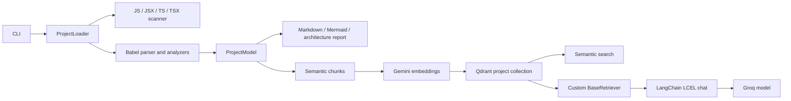

# Faro

Faro is a Repository Intelligence Platform for JavaScript and TypeScript projects. It turns source code into a `ProjectModel`, then generates Markdown documentation, Mermaid diagrams, architecture metrics, and an optional semantic knowledge layer for search and chat.

## Quickstart

Requires Node.js 20 or newer and Docker.

```bash
npm install
cp .env.example .env
# Fill in GOOGLE_API_KEY and GROQ_API_KEY in .env
docker compose up -d
node src/index.js generate ./
node src/index.js search "dependency graph"
node src/index.js chat
```

Documentation and graphs still generate if the Google key or Qdrant is unavailable. Search and chat require the knowledge layer; chat also requires the Groq key. See [GetStarted.md](GetStarted.md) for setup and command details.

## Architecture



The documentation stage runs for every generate command. The knowledge stage runs when `GOOGLE_API_KEY` is set and Qdrant is reachable. `reindex <projectPath>` rebuilds that project's collection; repeated `generate` runs use deterministic chunk point IDs.

## Tech stack

| Area | Technology |
|---|---|
| Static analysis | Babel parser and traverse, glob, graphlib |
| Embeddings | Google Gemini `gemini-embedding-001` via REST (v1beta), 768 dimensions |
| Vector database | Qdrant with project-specific collections and deterministic upsert IDs |
| LLM | Groq SDK, `openai/gpt-oss-20b` (`GROQ_MODEL` in `groqClient.js`) |
| Chat | LangChain LCEL, `@langchain/groq`, custom `BaseRetriever` |
| CLI | Commander and chalk |
| Runtime | Node.js >=20, ES Modules |

## CLI

```text
generate <projectPath> [--ai]
reindex <projectPath> [--ai]
status
search <query> [-o outputDir] [-k topK]
chat [query] [-o outputDir]
agent <taskType> [targetFile] [-o outputDir]
```

Agent task types are `refactor`, `test`, `readme`, `review`, `impact`, and `quality`. Generated files go to `output/` by default. The local `qdrant_meta.json` records which Qdrant collection contains the knowledge layer.
